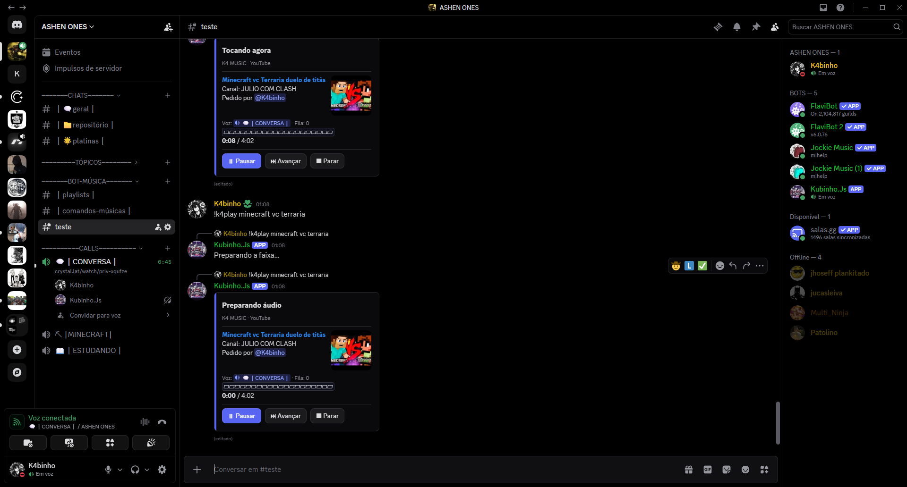

# K4Bot · Kubinho.Js

Bot Discord em desenvolvimento: TypeScript, busca no YouTube por nome ou link, tolerância a erros, fila por servidor e controles Pausar/Continuar, Avançar e Parar. Player renderizado com Sharp e botões nativos.

## Uso

Node.js 24. Copie `.env.example` para `.env` e preencha suas credenciais. Ative Message Content Intent no Developer Portal. Permita enviar mensagens, incorporar links, anexar arquivos, conectar e falar. Execute `npm install`, `npm run build` e `npm start`. Nunca publique `.env`.

- `!K4p nome ou link`: tocar/adicionar à fila.
- `!K4s`: parar e limpar fila.
- `!K4a`: próxima faixa.
- `!K4f`: fila.
- `!K4help`: ajuda.

Links de faixas do Spotify são resolvidos para versões correspondentes no YouTube. AutoPlay, favoritos e repetição ainda não estão disponíveis. A página local apresenta o projeto e os comandos. Fila e estado ficam em memória. A captura mostra o bot real antes do último redesign; o player atual usa uma imagem dinâmica. Os comandos /play e !K4p compartilham a fila e o player. O bot sai da call após três minutos com o player parado e a fila vazia. As edições estão sujeitas aos limites do Discord. Use conteúdo autorizado.
